# Campus Missions — Product Overview & Roadmap

## Product idea

Campus Missions is a place where students, clubs, and campus groups can post useful work for other students to take on. Missions can be practical or creative, local or remote, paid or non-cash. They are not limited to coursework.

Examples include:

- **Research and enquiries:** compare local prices, confirm public opening hours, collect public information, or summarize opt-in survey responses.
- **Campus and community:** help a student club, improve a campus service, or support new students.
- **Creative and media:** make posters, take event photos, or produce a short video.
- **Technology and data:** build a sign-up page, organize a spreadsheet, or summarize a dataset.
- **Events and logistics:** help run an event, check equipment, or coordinate volunteers.
- **Peer support and career:** review a portfolio, practice an interview, or share a skill.

Every mission should say what needs doing and what the helper should bring back. Enquiries and surveys should explain how the information will be used and avoid collecting sensitive personal details.

## Main user flow

```mermaid
flowchart LR
    A[Student or club posts a mission] --> B[Choose campus or remote]
    B --> C[Describe task and expected outcome]
    C --> D[Choose PayPal or local / non-cash reward]
    D --> E[Mission appears on the board]
    E --> F[AI suggests relevant missions]
    F --> G[Student accepts and completes work]
    G --> H[Organizer reviews the result]
    H --> I[Reward is confirmed or arranged]
```

## App structure today

| Part | File | Responsibility |
|---|---|---|
| Mission board and dialogs | [index.html](index.html) | Responsive page, seed missions, filters, mission details, post form, AI matching panel |
| Shared-board and sign-in behavior | [global.js](global.js) | Optional Supabase magic-link sign-in, shared mission reads and writes, accept/complete updates |
| Server APIs | [server.js](server.js) | Serves the app; connects to PayPal Orders and the AI model; sends sign-in links |
| Database and access rules | [supabase/schema.sql](supabase/schema.sql) | Mission fields, lifecycle states, indexes, grants, and row-level security policies |
| Setup and limits | [README.md](README.md) | Local run instructions, optional service configuration, and prototype boundaries |

### Mission record

The current record includes a title, description, expected deliverable, mission type, campus or remote scope, location, skills, organizer, reward type, and status. Statuses are `draft`, `open`, `accepted`, and `completed`.

### Integrations

- **AI matching:** ranks work using skills, interests, location, remote preference, and expected outcome. Model-backed matching needs `OPENAI_API_KEY`; otherwise the demo uses keyword matching.
- **Shared board:** Supabase Auth and Postgres can share missions and their status across users. This requires a dedicated Supabase project, the SQL setup, and environment variables. Without those, the app runs with browser-session demo content.
- **PayPal:** sandbox checkout can capture a mission reward in currencies supported by the configured PayPal merchant account. Captured funds go to the platform's configured business account; automated payment to a student is not implemented.
- **Regional rewards:** PayPal is not available for receiving funds in every market. Missions can instead offer a locally arranged or non-cash reward. The board can be used worldwide, subject to local connectivity and service availability.

## Roadmap

### 1. Finish the mission model — current step

- Agree on the first set of mission types and examples.
- Make enquiries and information gathering first-class missions with clear outcome fields.
- Keep on-campus and remote missions easy to distinguish.

### 2. Connect the shared board

- Choose a dedicated Supabase project and configure email sign-in.
- Apply the schema and use real accounts to post, browse, accept, and complete missions across browsers.
- Add organizer and campus details without exposing personal email addresses in public listings.

### 3. Make completion reviewable

- Let the helper submit links, notes, files, or evidence against the expected outcome.
- Add an organizer review step: submitted, approved, or revision requested.
- Keep a simple activity history so both sides can see what happened.

### 4. Make rewards work across markets

- Keep PayPal sandbox checkout for markets and currencies it supports.
- Design a verified reward release or payout flow before promising automatic student payments.
- Add local payment providers only where they are available and appropriate; keep a non-cash option for places without integrated payments.

### 5. Add trust and safety for community missions

- Add reporting and moderation for missions.
- Ask posters to identify the organizer and describe how collected information will be used.
- Add consent and data-minimization prompts for surveys or interviews.

### 6. Prepare the hackathon submission

- Finish one end-to-end demo with PayPal sandbox and model-backed matching configured.
- Publish the open-source repository with a license and complete run instructions.
- Record a concise public demo video showing the mission flow from posting through completion review.

## Recommended next build step

Connect the existing Supabase Auth and mission schema to a dedicated project, then walk through one real user journey: a club posts a research enquiry, a student finds it through matching, submits a short result, and the organizer reviews it. That will expose the missing product decisions before we expand the feature set.
