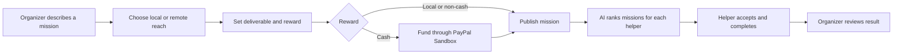

# Mission 360 — Product Overview & Roadmap

## Product

Mission 360 turns useful requests into clear, claimable missions. People or organizations describe the work, who can do it, where it can happen, what result is expected, and what reward is offered. Helpers browse locally or worldwide, use AI matching to find a fit, and share their result with the mission owner.

It is open to student groups and the wider community. Missions can involve practical help, community projects, research and enquiries, public information, creative work, technology, events, peer support, and career development.

## Current user journey

## Integrations

- **Supabase:** Auth magic links and shared mission storage; row-level security limits reads and writes.
- **AI:** model-backed ranking and short explanations based on profile and mission details. A local matcher is available only as a clearly marked fallback.
- **PayPal:** Sandbox Checkout Orders funds cash-reward missions. Funds land in the platform merchant account; helper payouts are not automated.

## Current boundaries

- Local and remote missions are supported. PayPal and country eligibility vary; local/non-cash rewards remain available.
- Mission completion is user-reported. There is no escrow, payout release, dispute flow, organization verification, or production moderation.
- Sensitive real-person investigations, missing-person searches, and crime bounties are not supported in this MVP. Those need verified partners, consent, private official tip routing, and strong moderation before implementation.
- The application is a hackathon prototype, not an emergency response or law-enforcement service.

## Roadmap

1. **Hackathon demo:** run Supabase Auth and shared mission board; show AI matching; demonstrate PayPal Sandbox funding and local/non-cash rewards.
2. **Trust basics:** organization verification, reporting/moderation, result review, and a simple dispute path.
3. **Regional readiness:** localize currency and language, set regional availability, and review privacy/payment rules market by market.
4. **Sensitive public-interest workflows:** only with authorized partners; require case verification and consent, route tips privately to official channels, and block surveillance, confrontation, and public accusations.
5. **Reward release:** investigate a compliant payout provider/workflow and recipient eligibility before promising payments to helpers.

## Repository map

| File | Role |
|---|---|
| `index.html` | Responsive app interface and demo missions |
| `global.js` | Supabase Auth, shared missions, and lifecycle |
| `server.js` | Static server, PayPal Sandbox, AI matching, `.env` loading |
| `supabase/schema.sql` | Fresh-project schema and row-level security |
| `supabase/migrations/` | Ordered updates for an existing database |
| `test/server.test.js` | API and server regression checks |
